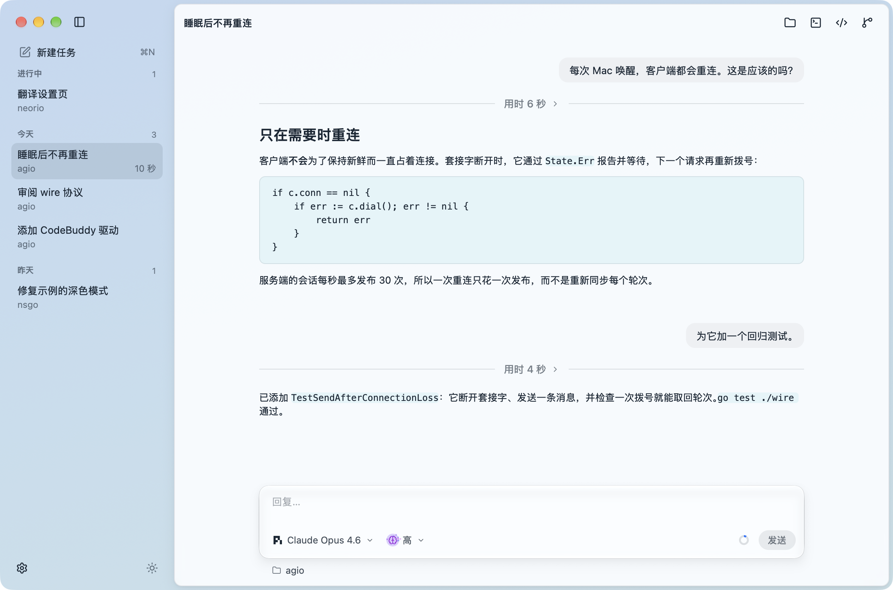

<h1 align="center">Agio</h1>

<p align="center">
  <strong>简体中文</strong> |
  <a href="README.md">English</a>
</p>

<p align="center">
  <a href="https://oneo-me.github.io/nsgo-agio/zh/"></a>
  <a href="https://github.com/oneo-me"></a>
  <a href="https://oneo.me"></a>
  <a href="https://x.com/oneo666"></a>
  <a href="https://github.com/sponsors/oneo-me"></a>
</p>

<p align="center">
  NSGo 应用的智能体核心：运行编程智能体（pi、Codex、Claude Code、CodeBuddy Code），并在手机与桌面上展示它们的工作，可在单个进程中运行，也可拆成服务端与客户端。
</p>

<p align="center">
  <picture>
    <source media="(prefers-color-scheme: dark)" srcset="website/src/assets/screens/zh/app-dark.png">
    
  </picture>
</p>

Agio 有两种身份：

- **库。** 其他 NSGo 应用在它之上搭建自己的开发环境：每个智能体 CLI 的驱动、在 macOS、Windows 或 Linux 上运行它们的 host、让其他进程或手机连接它们的 wire 协议，以及适配手机与桌面的视图，共用一套中立的 API。
- **应用。** `cmd/agio` 中的 Agio 就是这个核心本身，装进它自己的窗口，用于演示和测试，也是一个与智能体协作的简单工具：按项目组织的任务、智能体与模型设置、配色方案、通知和自动更新。

## 下载

从[最新版本](https://github.com/oneo-me/nsgo-agio/releases/latest)下载适用于 macOS、Windows 或 Linux 的 Agio，支持 arm64 与 x64。它会从 GitHub Release 自动更新：macOS 和 Windows 上直接安装，Linux 上打开发布页面。

Agio 用你自己的登录状态运行登录 shell 的 `PATH` 中的智能体 CLI。它会向 Umami 发送匿名使用统计：何时打开和使用，以及消息发给了哪些智能体，从不包含提示词或文件夹。`nsgo dev` 运行的构建不发送，也可在设置中关闭。

## 安装库

```sh
go get github.com/oneo-me/nsgo-agio@v0.1.0
```

需要 Go 1.27，以及登录 shell 的 `PATH` 中你想使用的智能体 CLI；它们使用你自己的登录状态运行。

## 使用

应用通过它展示的后端决定智能体在哪里运行。单进程时由 `host.Host` 运行：

```go
h := host.New(host.Options{Dir: workDir})
nsgo.Run(func(cx *core.Scope) core.Node {
	return chatview.App{Model: chatview.Bind(cx, h)}
})
h.Close()
```

服务端加客户端时，服务端提供它的 host，客户端改为展示 `wire.Client`：

```go
// 服务端
wire.ListenAndServe(host.New(host.Options{Dir: workDir}), "127.0.0.1:7788", token)

// 客户端
c, err := wire.Dial("127.0.0.1:7788", token)
nsgo.Run(func(cx *core.Scope) core.Node {
	return chatview.App{Model: chatview.Bind(cx, c)}
})
```

自有布局的应用可用 `chatview.Conversation` 展示单个对话；`wire.Serve` 可在任意字节流上提供服务，例如 SSH 会话。智能体对服务端文件拥有完全访问权限，因此请把服务端放在私有网络中并设置令牌。

Agio 在单进程中运行智能体；示例以服务端和客户端运行：

| 程序 | 运行 |
| --- | --- |
| Agio | `go tool nsgo dev cmd/agio` |
| 服务端 | `go run ./examples/server -token secret` |
| 客户端 | `AGIO_TOKEN=secret go tool nsgo dev examples/client` |

`go tool nsgo build cmd/agio` 为 macOS、Windows 和 Linux 构建 arm64 与 x64 的 Agio。构建时设置 `NSGO_UPDATES_KEY`（`cmd/agio/nsgo.yaml` 中 `updates.key` 对应的私钥），发布的版本就会从最新的 GitHub Release 自动更新。`go build -tags agiodemo ./cmd/agio` 构建一个展示脚本化任务、不运行智能体的演示版，官网截图用的就是它。

推送与 `cmd/agio/nsgo.yaml` 中 `version` 一致的 `v<版本>` 标签（如 `v0.1.0`）即发布该版本：Go 模块，以及 Agio 的 GitHub Release，发布说明取自 `CHANGELOG.md` 中该版本的一节，构建使用仓库密钥 `NSGO_UPDATES_KEY`。

## 文档

[ARCHITECTURE.md](ARCHITECTURE.md) 说明各个包及它们之间的边界。

## 开发

在仓库根目录运行 `go tool nsgo check` 和 `go tool nsgo test`。修改方式见 [AGENTS.md](AGENTS.md)。官网位于 [website/](website/README.md)。

发布说明见 [CHANGELOG.md](CHANGELOG.md)。

## 许可证

MIT，见 [LICENSE](LICENSE)。
